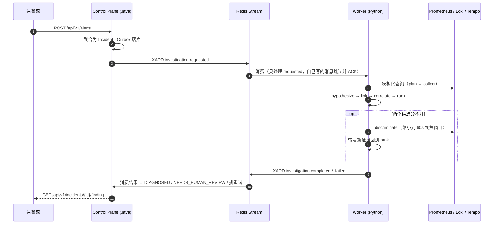
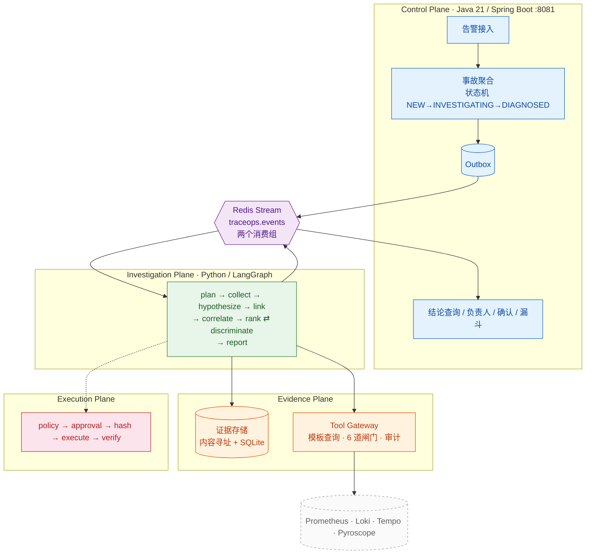

<div align="center">
  <h1>TraceOps</h1>
  <p><b>证据驱动的 Agentic 根因分析平台</b></p>

  <p>
    <a href="#项目简介">项目简介</a> •
    <a href="#核心设计">核心设计</a> •
    <a href="#评测结果">评测结果</a> •
    <a href="#系统架构">系统架构</a> •
    <a href="#快速开始">快速开始</a> •
    <a href="#已知局限">已知局限</a>
  </p>

  <p>
    
    
    
    
    
    
  </p>
</div>

---

## 项目简介

TraceOps 是一个面向微服务系统的故障调查平台：**一条告警进来，一份带证据的根因结论出去**。

它不做"把日志丢给模型让它猜"。整条链路是确定性的 —— 查询模板由部署方声明、证据先验证再采信、
根因假设必须有独立佐证才能成立、证据不足时**主动弃权**而不是硬给一个答案。
所有结论都能反查到具体哪几条证据、哪几条排序规则。

> **P0 没有 LLM 参与**：这一版全是确定性代码，目的是先把「证据 → 假设 → 排序 → 报告」
> 这条数据流做实。想验证"真模型那条路"通不通，跑 `python -m evaluation.model_check` ——
> 没配置端点时它明确返回 `UNVERIFIED`（退出码 2），而不是假装成功。

---

## 核心设计

### 证据不信任，先验证

四类证据（指标 / 日志 / 链路 / 事件）归一化后做内容寻址 checksum，篡改能被发现；
报告必须引用**已存在且已校验**的证据，否则 `ReportIntegrityError` 直接抛出，报告不落地。
证据落 SQLite，进程崩溃不等于可信性归零。

### 归因看"日志在说谁"，不看"谁上报"

```
order-service 上报的日志："ERROR redis timeout - connection pool exhausted"
  按上报者归因 → 判 order-service 拥有 redis 池（错）
  按文本归因   → 判 redis 才是根因（对）
```

`detectors.attribute_evidence` 是唯一事实来源，假设生成、证据关联、评估 precision 全走它。
修正后 F-001~F-005 的 rank 1 全部指向真正的下游依赖。

### 不确定是合法输出

三种情况主动降级为 `INCONCLUSIVE` 并说明缺什么：数据源缺失、无证据、多候选同分。
真实数据上 124 个案例里有 5 个注入幅度低于阈值，我们选择弃权 —— 朴素基线在这 5 个上靠硬猜得分，
代价写在分数旁边（见[评测结果](#评测结果)）。

### 契约跨语言，单一事实来源

`contracts/` 下 7 份 JSON Schema 同时约束两端：Java 生产出的**真实 Outbox payload**
被离线内联 `$ref` 后校验，Python 侧用 `referencing.Registry` 校验同一批文件。
schema 合法 ≠ 对方吃得下 —— Java 侧另有手写严格解析器做双向验证。

### 修复不由模型动手

执行平面是硬顺序，任何一步缺失即拒绝：

```
policy.allowed  →  approval == APPROVED  →  计划 content_hash 逐字节一致
                →  executor.execute      →  verifier.verify（不达标 → 回滚）
```

人工审批是**授权**不是**豁免**（审批不能越过策略），审批权与执行权职责分离（不能自批自放），
没有 `--executor-config` 时拒绝一切真实写操作。

### 一条告警的完整回路



重试次数、退避、放弃点全在控制面；agent 只提供 `is_retryable(reason)` 分类器。
**重试沿用最初观测窗口** —— 否则第二次调查看到的是"现在往前 5 分钟"，故障早滑出去了。

---

## 评测结果

同一套 `runner`、同一套指标，三种数据源。

**合成场景（12 个，按检测规则反向构造）**

| 指标 | 值 | 说明 |
|---|---|---|
| AC@1 | **0.91** | 11/12；漏的两个是 F-000（应弃权）与 F-010（设计内平局） |
| FT@1 | **1.00** | 机制（池耗尽 / 延迟劣化 / 依赖超时…）全对 |
| must_identify | 0.91 | F-007 双故障只报出 redis，`billing-api` 从未被采集 |
| 弃权率 | 0.08 | 只有健康对照 F-000 弃权 |
| lift@1 | **3.64** | 对阵 `chance@1 = 0.25`（候选池平均 4 个） |
| citation precision | 0.70 | F-008 宽候选池 0.40、F-009 高分行骗 0.33 拉低 |

**真实数据集（RCAEval，同一批案例对照两种输入）**

| 数据集 | AC@1（无调用图 → 有调用图） | 峰值基线 | 结论 |
|---|---|---|---|
| RE1-OB（124/125 可导入） | 0.86 → **0.89** | 0.87 → **0.90** | 仍差 1 个点 |
| RE2-OB（214，含日志与链路） | 0.72 → **0.92** | 0.90 → **0.92** | 打平 |

RE2-OB 拆开看：真因服务有"自耗时异常"证据的 42 个案例，答对 **40 个（95%）**；
其余 172 个没有这个信号，答对 115 个（67%）。错的地方集中在"数据里根本没有这个信号"。

> - **`AC@3` / `AC@5` 不可引用**：最大候选池只有 4 个，`AC@5` 是数学恒等式。只看 `lift@1`。
> - **峰值基线打平不是胜利**：它靠"取最大值"这一行代码拿到的，我们靠证据链。
> - 合成场景按检测规则反向构造，存在**规则自证**风险；它证明的是"实现没跑偏"，不是"现实准确率"。
> - `FT@1` 在 RE2 只有 0.68：数据集标注"注入了哪种故障"，我们报"观测到哪种机制"，两者不等价。
> - 完整口径与逐场景数字见 [评测口径]。

---

## 系统架构



调查图 8 个节点，唯一的回路是 `rank ⇄ discriminate`：两个候选分不开时，把窗口缩到 60 秒重新取证，
最多两轮（`DISCRIMINATION_ROUNDS = 2`）。每次取证算"一轮"，预算只在 `collect` 节点扣 —— 节点数不是成本。

---

## 快速开始

| 依赖 | 版本 | 必需 |
|---|---|---|
| Python | 3.11+ | ✅ 证据引擎、调查图、评估 |
| Java / Maven | 21 / 3.9+ | ✅ 控制面 |
| Docker | 最新稳定版 | ⬜ 只有跑观测栈时需要，单测与 demo 不需要 |

```bash
git clone https://github.com/zhentaozhang/traceops.git && cd traceops

# Python 侧
python -m venv .venv && source .venv/bin/activate
pip install -e "agent-runtime[test]"

# 30 秒：看到一次完整诊断（合成遥测，不需要 Redis / Docker / 模型）
PYTHONPATH=agent-runtime python -m traceops.cli.demo

# 全部测试（1541 Python + 237 Java）
PYTHONPATH=agent-runtime python -m pytest agent-runtime/tests evaluation contracts -q
cd control-plane && mvn -B test && cd ..
```

> 本机 `~/.m2` 不可写或 Maven Central 直连 403 时，改用 `mvn -s .mvn/settings.xml -B test`
> （该文件把本地仓库放进工作区并镜像到阿里云）。CI 用默认的 Maven Central，不传 `-s`。

不想跑也能看产物：[诊断示例] 是一次真实输出的存档
（结论 / 为什么信 / 下一步 / 不确定的地方 / 成本 / 候选排名）。

**关键入口**

| 命令 | 做什么 |
|---|---|
| `python -m evaluation.runner` | 跑 12 个合成场景，输出指标 + 每场景一份可读诊断 |
| `python -m scripts.smoke_loop` | Java → Python → Java 闭环冒烟（含契约校验） |
| `python -m traceops.cli.worker --mode memory --once --self-check` | worker 自检 |
| `python -m evaluation.blind export --out /tmp/blind-pack` | 导出盲测包（别人能用同一套指标测我们） |

**控制面**：`mvn spring-boot:run` 起在 `:8081`，`POST /api/v1/alerts` 投一条告警，
`GET /api/v1/incidents/{id}` 看它**此刻卡在谁那里**（`stage.kind` / `stage.waitingOn`）——
`INVESTIGATING` 一个词背后有四种处境：等认领、在跑、卡退避、已经死了。

**观测栈**：`cd demo-environment/observability && docker compose up -d`
（Prometheus 9090 / Loki 3100 / Tempo 3200 / Grafana 3000）。

> 接入自己的集群前先读 [`运行手册`] §3 —— 采集约定（指标名、标签、
> 服务名必须与拓扑逐字符一致）不匹配时，查回来的每一份数据都会被判成"空结果"，
> 而报告只会说"查了但没有"。

---

## 技术栈

| 分类 | 技术 |
|---|---|
| Investigation Plane | Python 3.11 · LangGraph 1.2 · Pydantic 2 |
| Control Plane | Java 21 · Spring Boot 3.5 · Flyway（默认 H2 内存库，`TRACEOPS_DB_URL` 可换） |
| 跨语言契约 | JSON Schema 2020-12（`jsonschema` + `referencing` / `json-schema-validator`） |
| 状态与消息 | Redis Stream（消费组 + 死信）· Outbox 模式 |
| 存储 | SQLite（证据 / 账本 / 审批）+ JPA |
| 观测 | Prometheus · Loki · Tempo · Pyroscope · Grafana（含 mcp-grafana） |
| 测试 | pytest（1541）· JUnit 5（237）· GitHub Actions（Python 3.11/3.12 + Java 21） |

---

## 项目结构

```
traceops/
├── contracts/                  # Java↔Python 版本化事件契约（JSON Schema 单一事实来源）
│   ├── common/                 #   事件信封、时间窗口
│   ├── events/v1/              #   investigation.requested/updated/completed/failed
│   └── tests/                  #   两侧共用的契约测试
├── control-plane/              # Java 21 · Spring Boot：状态机 + Outbox + Web + 契约校验
├── agent-runtime/              # Python：证据引擎 + 8 节点调查图 + 工具网关 + 规则 RCA
│   ├── traceops/orchestration/ #   graph.py（图与路由）、detectors.py（归因）
│   ├── traceops/rca/           #   ranking.py（R-001~R-011）
│   ├── traceops/evidence/      #   归一化、校验、SQLite 存储、查询模板
│   ├── traceops/remediation/   #   policy / approval / executor / verifier
│   └── traceops/security/      #   提示注入中和、职责分离
├── evaluation/                 # 12 个合成场景 + harness + 18 个指标 + runner CLI
├── demo-environment/
│   └── observability/          # Prometheus + Loki + Tempo + Grafana（docker compose）

```

---

## 文档

| 文档 | 回答什么 |
|---|---|


---

## 已知局限

- **没有真实靶场**：`demo-environment/ticketflow`（被测系统）与 `fault-controller`（故障注入器）是空目录，
  目前只能用合成遥测与 RCAEval 离线数据，真实注入实验（S4/S5）未做
- **基础设施依赖强**：诊断质量取决于采集约定与服务名一致性，接错名字系统会安静地判断"一切正常"
- **Tempo 2.5 下 `get_tempo_trace` 恒 404**（缺 `/api/v2/traces`），已降级为 spanSet 构造并标 `degraded=True`
- **LangGraph checkpointer 未接线**：worker 调 `run_investigation` 时没传 `checkpointer` / `thread_id`，
  跨进程崩溃恢复尚未生效（P2）
- **E4/E5 消融测不出差异**，且是**结构性**的：语义闸门与候选生成的触发条件互斥（`coverage==0` 不可达），
  这两个闸门在确定性路径上只是防御性代码
- 缺省 worker 不持久化任何东西，`--memory-db` / `--ledger-db` / `--approval-db` 三条路要显式给
